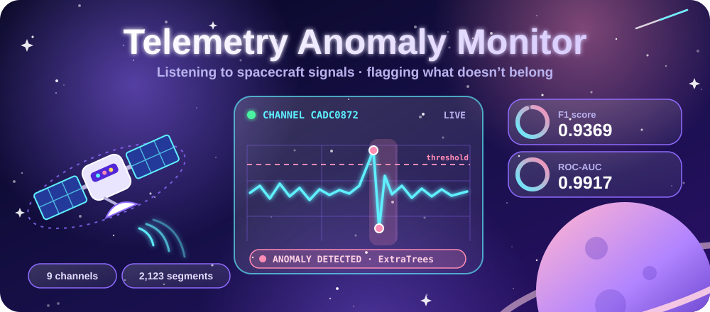

# Telemetry Anomaly Monitor

<div align="center">
  
</div>

<br/>

<div align="center">
  
  
  
  
  
</div>

<p align="center">
  <a href="#dataset">Dataset</a> ·
  <a href="#model-design">Model</a> ·
  <a href="#evaluation-on-official-holdout">Results</a> ·
  <a href="#run-locally">Run it</a> ·
  <a href="#api-example">API</a>
</p>

---

A complete machine-learning project built from the supplied telemetry dataset.

## What's Inside

| Component | Description |
|---|---|
| **Reproducible training** | Uses the dataset's official `train`/`test` split |
| **ExtraTrees classifier** | Supervised anomaly detection |
| **Validation-selected threshold** | Probability cutoff chosen on a validation subset |
| **Isolation Forest** | Optional, for unlabeled or out-of-distribution scoring |
| **Streamlit dashboard** | Interactive exploration and batch CSV scoring |
| **Flask web app and JSON API** | Score a segment from the browser or from code |
| **Jupyter notebook** | End-to-end analysis and training workflow |
| **Technical report** | Detailed write-up in Markdown and PDF |

## Dataset

<div align="center">

| Segments | Model features | Channels | Signal rows | Target |
|:---:|:---:|:---:|:---:|:---:|
| **2,123** | **20** | **9** | **303,493** | **Binary anomaly** |

</div>

The supplied `dataset.csv` contains 2,123 telemetry segments, 20 model input features after excluding identifiers and labels, 9 channels, and a binary anomaly target. `segments.csv` contains the underlying 303,493 signal rows.

## Model Design

```text
Telemetry features (20)
        |
        v
ExtraTreesClassifier (500 trees, min leaf 2, balanced class weights)
        |
        v
Anomaly probability
        |
        v
Validation-selected threshold (max F1) --> Normal / Anomaly
```

**Primary model:** ExtraTreesClassifier with 500 trees, minimum leaf size 2, and balanced class weights.

**Threshold:** Selected on a stratified validation subset of the official training data by maximizing F1, then the final model is refit on all official training rows.

**Secondary detector:** Isolation Forest, useful when labels are unavailable.

## Evaluation on Official Holdout

<div align="center">
  
  
  
  <br/>
  
  
  
</div>

<br/>

| Metric | Value |
|---|---:|
| Accuracy | **0.9735** |
| Precision | **0.9541** |
| Recall | **0.9204** |
| F1 | **0.9369** |
| ROC-AUC | **0.9917** |
| PR-AUC | **0.9780** |

**Confusion matrix:** `[[411, 5], [9, 104]]`

| | Predicted normal | Predicted anomaly |
|---|:---:|:---:|
| **Actual normal** | 411 | 5 |
| **Actual anomaly** | 9 | 104 |

> These are measurements on this supplied dataset and should not be interpreted as production spacecraft performance.

## Run Locally

```bash
pip install -r requirements.txt
python src/train_model.py
streamlit run app_streamlit.py
```

For Flask:

```bash
python app_flask.py
```

Open `http://127.0.0.1:5000`.

## API Example

POST JSON to `/predict`:

```json
{
  "channel": "CADC0872",
  "sampling": 1,
  "duration": 279,
  "len": 280,
  "mean": 8.53e-7,
  "var": 3.49e-10,
  "std": 1.9e-5,
  "kurtosis": 0.63,
  "skew": 0.55,
  "n_peaks": 4,
  "smooth10_n_peaks": 3,
  "smooth20_n_peaks": 2,
  "diff_peaks": 4,
  "diff2_peaks": 6,
  "diff_var": 1.27e-10,
  "diff2_var": 2.96e-10,
  "gaps_squared": 279,
  "len_weighted": 280,
  "var_div_duration": 1.25e-12,
  "var_div_len": 1.25e-12
}
```

## Project Structure

```text
telemetry_anomaly_project/
├── assets/
│   └── banner.svg
├── app_streamlit.py
├── app_flask.py
├── README.md
├── REPORT.md
├── REPORT.pdf
├── requirements.txt
├── data/
│   ├── dataset.csv
│   └── segments.csv
├── model/
│   ├── telemetry_extratrees.joblib
│   ├── telemetry_isolation_forest.joblib
│   └── metadata.json
├── notebooks/
│   └── telemetry_anomaly_project.ipynb
├── src/
│   └── train_model.py
└── templates/
    ├── index.html
    └── result.html
```

<br/>

<div align="center">
  <sub>Built with scikit-learn, Streamlit and Flask.</sub>
</div>